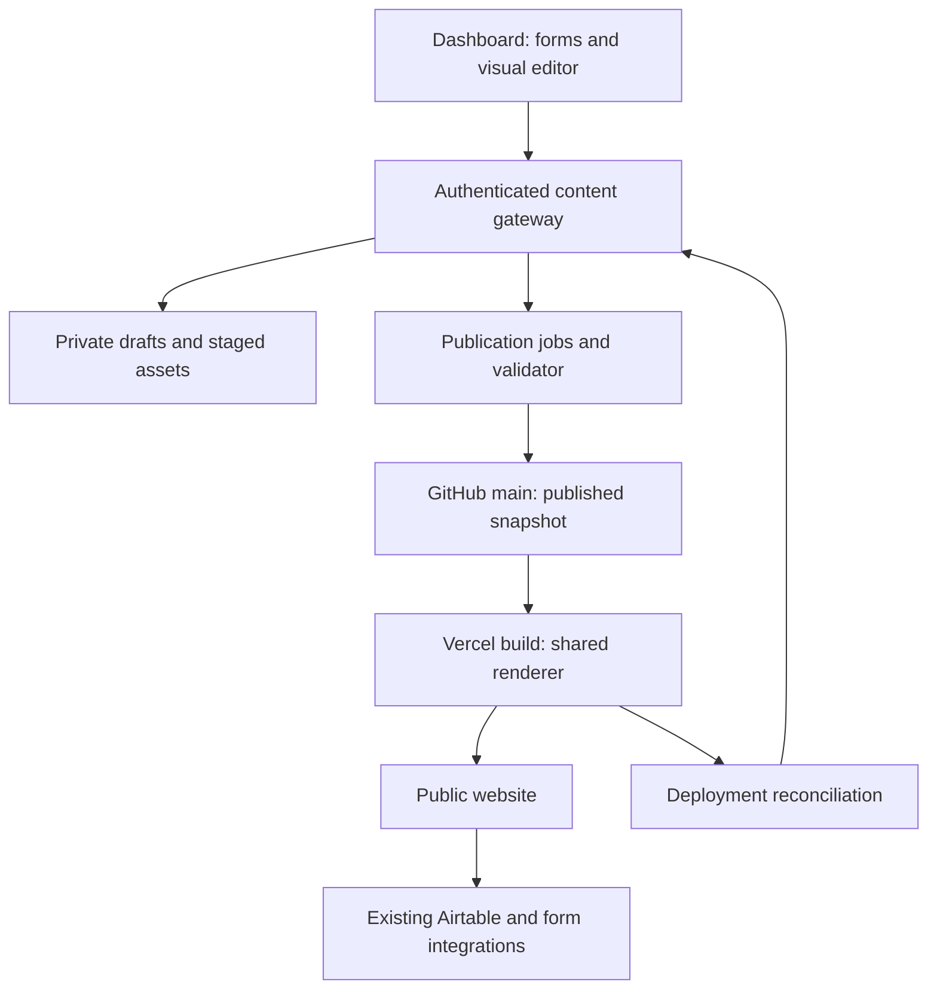

# Target architecture and decision records

Status: proposed design for implementation review. Decisions marked recommended are engineering defaults, not claims that the owner selected vendors or access policies.

## System boundaries

The editor owns authoring interactions. The gateway owns permissions, validation, revision checks and path mapping. Private storage owns work in progress. GitHub owns published source/version history. The build owns static HTML/CSS generation. Public runtime adapters own small interactive behaviors and live external reads.

## Proposed repository layout

These are intended implementation locations, not existing files or created application code:

| Path | Responsibility |
| --- | --- |
| `editor/src/` | React editor shell, canvas controls, local state and API client |
| `content-core/` | Runtime schemas, component definitions, adapters, semantic validation and migrations |
| `content-renderer/` | Shared React/static renderers plus approved browser interaction modules |
| `api/_studio/` | Gateway, storage/auth ports, publication service and GitHub adapter |
| `api/studio-*.js` | Small explicit Vercel entrypoints corresponding to the proposed API contract |
| `scripts/build-pages.cjs` | Render only manifest-owned page outputs, then invoke metadata build in defined order |
| `content/pages/` | Published layout documents, outside served root; no private drafts |
| `content/page-manifest.json` | Explicit IDs, canonical routes, outputs, ownership mode and component versions |
| `public/dash/editor-assets/` | Built editor bundle; excluded from public page runtime |
| `tests/editor/` | Contract, browser, rendering, publication, migration and regression fixtures |
| `docs/editor/` | Reviewed architecture, runbooks and contract documentation from this handoff |

Do not scatter editor state into `public/script.js` or convert the entire website to Next.js. Package/build tooling can be introduced for the editor and renderer without changing the site's hosting model. Decide module interop explicitly: existing API/build code is CommonJS; a Vite/TypeScript bundle must produce a tested Node-compatible build artifact or a deliberately selected module boundary.

## Dependency rules

1. `content-core` imports neither editor UI nor storage/network clients.
2. The renderer accepts validated documents plus a resolved immutable dependency snapshot. It does not fetch mutable GitHub main during rendering.
3. Editor UI invokes typed operations; it cannot send arbitrary output paths, HTML scripts or repository config changes.
4. API entrypoints remain thin; runtime credentials are available only to server adapters/workers.
5. Public pages receive static HTML, compiled CSS and approved interaction modules—not editor state/history or private draft references.
6. Legacy form saves and visual editor saves converge at the same content gateway before an affected resource is enabled for both.
7. The build and private preview use the same renderer/component registry version. Editor selection overlays are outside exported content.
8. The publication reconciler must survive process restarts. Background work cannot rely on an unawaited promise after a serverless response.

## Architecture decisions

| ID | Decision / status | Reason | Consequence / revisit trigger |
| --- | --- | --- | --- |
| ADR-01 | Structured section documents; recommended | Redesign-safe field ownership and controlled layouts | Arbitrary HTML import requires a separately reviewed mode |
| ADR-02 | OpenPage editor subset; provisional | Closest useful layer/block UI among inspected repos | Retain only if extraction proof meets E03; swap UI adapter if it fails |
| ADR-03 | Keep current public hosting/dashboard shell; recommended | Limits regression surface | No framework migration required for initial editor |
| ADR-04 | Shared renderer for preview/static output; recommended | Avoid independent exporters drifting apart | Build CJS/ESM and CSS handling must be proven |
| ADR-05 | Private authoring storage, Git published source; recommended | Draft privacy and fewer unnecessary deployments | Storage provider and operational backup remain open |
| ADR-06 | One write gateway; required invariant | Prevent conflicting sources and lost updates | Legacy endpoints delegate for enabled resources |
| ADR-07 | Main-only publication via one Git commit; user workflow carried forward | Keep existing direct-main process | Full preflight before ref update; branch protections still respected |
| ADR-08 | Individual actors/roles before production ownership; recommended | Shared credential cannot support true per-user permissions | Identity provider and onboarding/recovery need owner choice |
| ADR-09 | Airtable remains authoritative; required invariant | Preserve existing calendar synchronization | No page release can roll back external records automatically |
| ADR-10 | Explicit per-route ownership/cutover; required invariant | Avoid legacy and new build writing same output | One route at a time; change manifest and renderer in compatible release |
| ADR-11 | Server-only token/keys; required invariant | Current auth already retired browser token handoff | Never revive Decap direct-write auth as shortcut |
| ADR-12 | Explicit global-dependency inclusion; recommended | Page publish must not leak unrelated settings drafts | Global impact shown in review, all selected revisions pinned |

## Provider-neutral service ports

| Port | Minimum behavior |
| --- | --- |
| Identity | Verified actor ID, server session, role/page grants, revocation, recovery and audit-safe display name |
| Draft store | Conditional revision updates, immutable snapshots, transactions for related records, backup/restore and authorization isolation |
| Asset store | Private upload/read, short-lived authorized access, content hashing, immutable promotion and retention tracking |
| Job runner | Durable enqueue, deduplication, bounded retries, leases/fencing and restart-safe execution |
| Git publisher | Read main/content hashes; create blobs/tree/commit; non-force ref advance; compare ancestry; bounded history reconciliation |
| Deployment monitor | Correct team/project identity, commit/deployment correlation, state polling, optional signed webhook and production verification |

Select concrete providers after a capability proof. A SQL database plus private object storage is the default shape; this document does not assume existing paid services, accounts or entitlements.

## About and metadata ownership

Use an adapter phase first: `about.md` continues to own text, order and visibility. A new layout document references stable section IDs and approved variants. Reordering existing About sections through the visual UI writes the About resource through its adapter; it does not create a second independent ordering list.

The target renderer composes the adapter-resolved sections with the philosophy template and optional suffix. At cutover, the legacy build must stop writing About body markup, while its metadata/favicon pass can continue. Split the current combined build responsibilities deliberately; two scripts cannot both regenerate the body.

## Operational model

Flags are proposed server/developer configuration, not editable team fields: editor visibility, draft writing, preview, publication, and per-route render mode. Enforce write flags on the server even if a browser has an old bundle. The safe default for every existing route is `legacy`.

Monitor draft failures, revision conflicts, publish queue age, ref conflicts, deployment failures, live verification latency and storage recovery failures. Record IDs/hashes, never draft bodies, tokens or sensitive form content in ordinary logs. Make “disable new publication but keep existing site live” a documented action.

