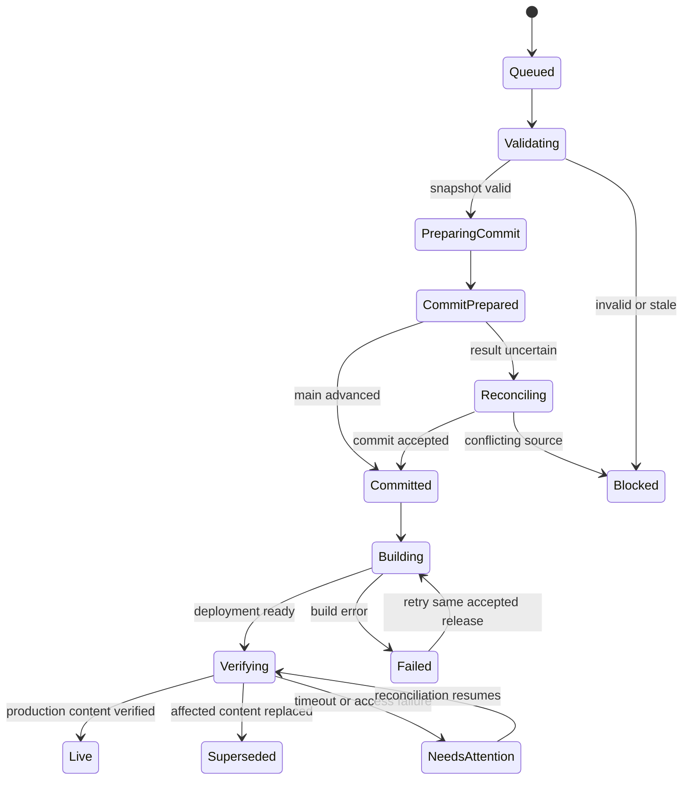

# Publication, deployment and recovery protocol

Proposed protocol. GitHub, private storage and Vercel are separate systems: no transaction spans them. Durable job records, immutable snapshots, idempotency and reconciliation make partial completion recoverable.

## Invariants

- One release advances `main` once with all selected content/layout/asset references and release metadata. No branch, PR, force-push or repository reset.
- Published source is validated server-side. Client HTML is not trusted as build input.
- One affected source path has one canonical owner and one baseline hash.
- The job records its intended commit **before** attempting a ref update. This makes a lost response recoverable.
- Private draft cleanup does not determine whether a valid Git release succeeded.
- A deployment ready event is evidence about a deployment, not proof that the public production URL serves its content.

## State model

States are persisted with attempt history. “Blocked” is precommit and safe to revise. “Failed” after commit must keep the accepted commit identity; never present it as if nothing was saved. Cancellation is allowed before ref update; after acceptance it cannot erase history and instead offers a new restore release. Only workers with a current lease/fencing token update a job; lease expiry cannot authorize two concurrent ref writers.

## Ordered algorithm

1. Authenticate actor, authorize page and selected resources, enforce publication flag and idempotency key/body hash.
2. Atomically create/find the publication job and freeze selected immutable revisions. Pin the complete set of inputs: layout, About/content resources, published-or-selected Settings, template/renderer versions and selected assets.
3. Resolve bindings and validate structure/semantics, public routes, required integration configuration, URL/media safety, SEO and component compatibility. Compute canonical serialization and hashes using the v1 rule below; avoid comparing unstable JSON key orders.
4. Render in an isolated preflight environment using the same trusted build/renderer version. Generate manifest/hash evidence. Long builds/browser tests use a durable worker, not detached work after an API response.
5. Read main commit/tree and affected source hashes. If a selected resource changed since its baseline, block or open an explicit reconciliation; do not use a broad last-write-wins replacement.
6. Build a complete tree using current main as base. Include selected resource updates, page layout and new immutable asset files; preserve every unrelated path. Do not publish staged files that were not selected. A future larger-asset pipeline must promote immutable objects before committing their references; garbage collect orphans later.
7. Create Git objects and a commit whose single parent is the validated current head. Include release ID in the commit message and the release descriptor. Save intended commit SHA/tree/parent in the private job before ref update.
8. Recheck worker lease, then request non-force main update. If head advanced, re-read main; revalidate all affected source hashes and rerun exact-tree preflight as needed. Preserve the same selected immutable revisions but create a new commit against the new head. Limit automatic attempts (initial target: 3), then report contention. Do not reuse a preflight result if unrelated code changes alter renderer/build semantics.
9. On success, record accepted commit. On network ambiguity, inspect main and ancestry for the prepared commit/release ID before retrying. Main may already be a descendant; exact equality is not required. If neither acceptance nor rejection can be established, remain reconciling and block duplicate publication of that job.
10. Monitor the intended Vercel team/project and deployment associated with accepted SHA. Retry monitoring independently of Git publication. Webhooks are optional accelerators, verified according to the configured provider mechanism; polling/reconciliation remains available for missed/out-of-order events.
11. After ready, fetch the production origin and release marker plus affected route outputs. Compare release ID, resource/content hashes and renderer version. Follow expected canonical redirects deliberately. Do not accept a login/protection HTML page, a cached previous response or a deployment-specific URL as proof of the production alias.
12. Mark live when affected content matches. If a newer application commit preserves the same release/content hashes, it can still serve the release; record both accepted release commit and observed deployed commit. If affected content has changed, mark superseded. If status is unavailable, say verification pending/needs attention, not live.
13. Reconcile private published heads and archive only the exact published draft revisions. Newer drafts remain and get their baseline/merge status updated explicitly. Audit actor, scope, commit, deployment and verification evidence.

GitHub's tree/commit/ref APIs support a single tree snapshot and non-force advancement. They do not provide a multi-resource application merge or a comparison-and-swap on private draft records; those guarantees belong to this protocol. See the official sources in the source register.

## Release descriptor

### Snapshot hash v1

Build a JSON envelope with `hashVersion: 1`, page document, selected resource contents/revision IDs, asset content hashes, and template/component/renderer versions. Exclude private storage URLs, wall-clock timestamps, job status, UI state and deployment state. Recursively sort object keys by UTF-16 code-unit order, retain array order, serialize without whitespace using the shared JavaScript JSON string/number rules, and hash the exact UTF-8 bytes with SHA-256. Do not normalize user Unicode text or append a newline to hashed bytes. Reject undefined/non-JSON values and non-finite numbers before serialization; normalize negative zero to zero. V1 document layout tokens/versions avoid floating-point values; any component needing numeric props must define allowed bounds explicitly.

Implement this algorithm once in the shared core and use that compiled implementation in browser/server/build. Add golden vectors for reordered object keys, preserved array order, Unicode/surrogate handling, empty values and rejected invalid numbers. Hash version changes require a new version and regenerated previews, not a silent algorithm replacement. File blob hashes returned by GitHub remain distinct from this application snapshot hash.

### Descriptor contents

Proposed persisted fields: release ID, page IDs/routes, selected resource IDs and before/after hashes, layout/schema/component/renderer versions, selected asset hashes/paths and restoration scope. A descriptor committed in Git cannot contain its own resulting commit SHA without a circular dependency. Store accepted commit in the private release record; build can expose the hosting-provided commit identity alongside descriptor ID/hash.

The public marker must contain only public metadata. It can identify page release/content hashes, never actor emails, private draft keys, signed URLs, form records or tokens. Build output updates the marker from committed public sources; an API cannot claim live by updating a private DB alone.

## Freeze semantics

The user reviews revision R and publishes R. Typing after review creates R+1; it does not mutate the pending snapshot. Save and Publish states can therefore coexist: “Release building; newer changes unsaved.” Completion of R cannot clear local recovery or shared draft R+1.

For bound resources, a single-page release defaults to published global data. Explicitly including a Settings draft may affect every route. The review shows that global scope. No hidden promotion of teammate drafts and no automatic publication of every photo flagged draft.

## Authorization failures

Preserve HTTP status, operation, safe upstream code/message and correlation ID in the job. Explain the narrowest restriction supported by evidence:

- Contents permission missing/insufficient or repository not included in credential scope.
- Main protected by a rule requiring another workflow or signed commits.
- Token expired/revoked or installation suspended.
- Vercel team/project inaccessible to the runtime credential.

If evidence only says forbidden/not found, do not invent a precise permission cause; surface “restriction not yet distinguishable” and the safe returned details. A 422 is not automatically a stale edit: it can be schema/ref validation. Differentiate Git conflict from authorization from validation errors.

## Failure recovery table

| Checkpoint | Persisted evidence | Recovery |
| --- | --- | --- |
| Draft saved, no job | Draft revision/hash | Create normal publication request |
| Snapshot frozen, validation fails | Job + field errors | Edit into a new revision; re-review |
| Objects created, ref not advanced | Intended tree/commit | Reconcile head; retry only if safe/current |
| Ref advanced, API response lost | Prepared commit/release ID | Discover acceptance/ancestry; no duplicate commit |
| Git accepted, private DB unavailable | Git descriptor and intended commit | Reconcile DB from Git on recovery |
| Build failed | Accepted commit/deployment error | Preserve draft/release, repair/retry or scoped restore |
| Deployment ready, alias stale | Deployment evidence and marker mismatch | Continue bounded checks; report pending |
| Newer conflicting release | Different affected hashes | Superseded; do not relabel older content live |
| Cleanup fails | Accepted live release + exact revision | Retry cleanup independently |

## Direct-main tradeoff

Local/durable preflight catches failures before ref update, but production cannot offer a zero-risk staged promotion while every accepted main push automatically deploys. A production build can succeed yet contain a behavior regression. The launch gate therefore requires a small pilot, functional smoke checks, a publication kill switch and a tested restore. If pre-production deployment approval later becomes mandatory, revisit the deployment workflow explicitly; do not pretend a preview inside the editor is an equivalent production environment.

